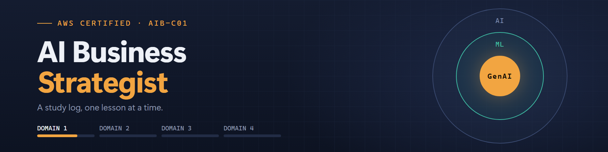
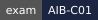
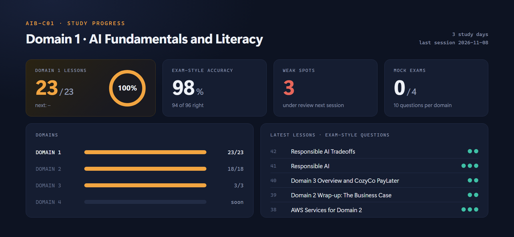

  

<!-- badges:start -->

<!-- badges:end -->

### Studying for the AWS Certified AI Business Strategist, out loud.

A personal tutor for the AIB-C01 exam, run by Claude Code. 
Every lesson is explained, tied to real client work and tested with exam-style questions.

---

---

## The brief

The AIB-C01 is a business exam, not a technical one: when AI is the right tool, what it costs and returns, and how it is governed and kept working. Watching slides about that is the slowest way to learn it. So the course runs through a tutor instead.

Each lesson goes in as a transcript and comes back as a short explanation, what the exam will ask about it, an example from real work (small businesses in Uruguay, websites, Google Ads and Meta Ads campaigns) and two or three scenario questions, one at a time. A wrong answer gets a hint before it gets the answer. Every miss becomes a weak spot, and the next session opens with questions on it. Each domain closes with a 10-question mock exam, no hints.

## Under the hood

No app, no server. The tutor is [Claude Code](https://claude.com/claude-code) following [CLAUDE.md](CLAUDE.md), which sets the method, the language (Rioplatense Spanish, exam terms kept in English) and the rules: short answers, one idea at a time, nothing taught that is not in the course or the official exam guide.

[progress.md](progress.md) is the single source of truth: lessons, scores, weak spots and mock exams. `node design/readme/build.mjs` reads it, rewrites the badges and the table below, and renders the banner and the progress card above from two HTML pages in headless Chrome or Edge. No dependencies beyond Node.

The course transcripts and slides stay on my machine: they belong to the course and are not in this repository.

## Progress

<!-- progress:start -->
| | Domain | Lessons | Exam-style | |
|---|---|---|---|---|
| 1 | AI Fundamentals and Literacy | 23/23 | 54/54 |  |
| 2 | AI Strategy and Business Value Creation | 18/18 | 33/35 |  |
| 3 | AI Governance and Responsible AI Leadership | 3/3 | 7/7 |  |
| 4 | _not reached yet_ | – | – |  |

**Weak spots under review** (logged in Spanish, as studied):

- Baseline creíble: confundió "mismo método" con "mismos datos" y no detectó períodos no comparables (enero vs Black Friday) como lo que debilita un antes/después. Repasar los 3 chequeos (registrado antes, misma medición, período comparable).
- Cost ownership: con iniciativas ya probadas y costo sin dueño, eligió agrandar el pozo central y confundió la opción "proven → equipo que se beneficia" con "cobrar desde el día uno". Repasar: experiments → central AI budget, proven → cost center del equipo, por uso.
- Tareas del dominio 3: puso governance body + risk classes en "Enterprise AI risks". Repasar el orden: principios (responsible AI en decisiones) → estructuras (governance y compliance) → riesgos en producción (monitoring, bias, harmful content, IP, reliability).

Generated from [progress.md](progress.md) by `node design/readme/build.mjs`. Last session: 2026-11-08.
<!-- progress:end -->

## License

&copy; 2026 [Luis Barral](https://barral.dev). All rights reserved. The code and notes are public to read, not to reuse: copying or adapting them needs written permission. See [LICENSE](LICENSE).

AWS and AWS Certified AI Business Strategist are trademarks of Amazon.com, Inc. or its affiliates. This is a personal study log, not affiliated with or endorsed by AWS, Udemy or the course author.

**[Luis Barral](https://barral.dev)** &middot; All rights reserved

